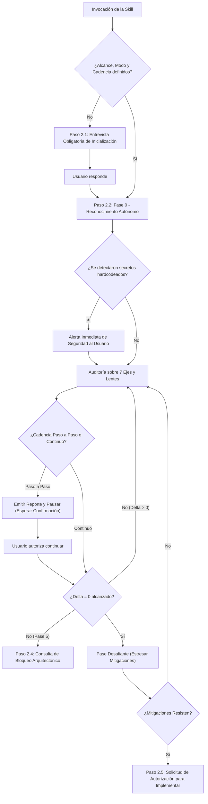
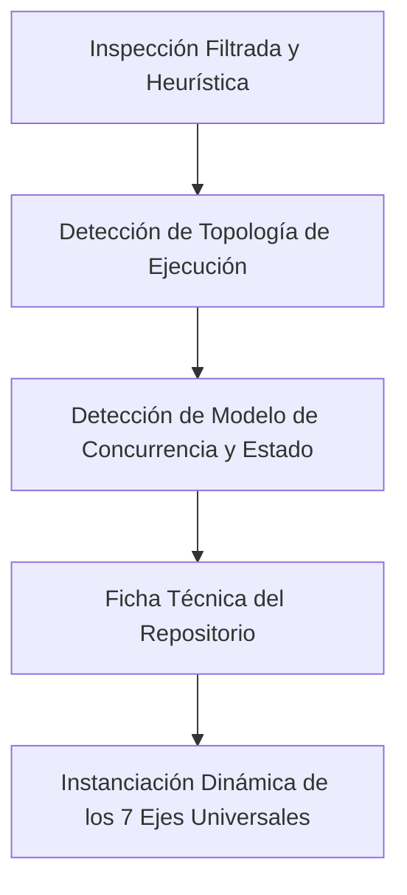
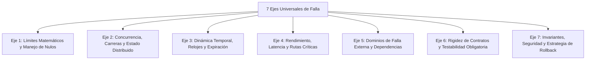
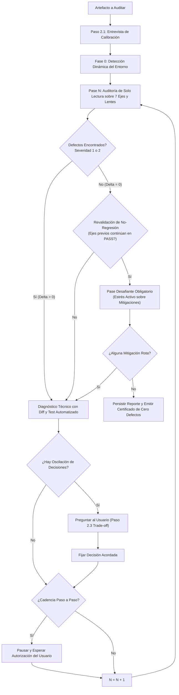

# Skill: Auditoría Adversarial Universal y Detección Recursiva de Fallos (Universal Adversarial Review)

Esta skill establece un protocolo adversarial universal y auto-adaptable. Permite detectar proactivamente fallos arquitectónicos, condiciones de carrera, cuellos de botella, vulnerabilidades y roturas de contrato antes de escribir o desplegar código.

La skill no asume tecnologías preconcebidas. Dispone de un mecanismo de inspección autónoma (Fase 0) que analiza la estructura, dependencias, variables y configuración del repositorio.

---

## 1. Las Leyes de Hierro de la Auditoría Adversarial

### Ley 1: Suposición de Falla Catastrófica
```
ASUME QUE EL SISTEMA YA FALLÓ DE FORMA CATASTRÓFICA EN PRODUCCIÓN.
DEMUESTRA CÓMO Y POR QUÉ FALLÓ BAJO CONDICIONES ADVERSAS DE CONCURRENCIA Y TIEMPO DE EJECUCIÓN.
```
Un auditor adversarial no busca razones para aprobar una propuesta. Busca activamente cómo romperla usando fallos de red, límites matemáticos, eventos concurrentes y estados degradados.

### Ley 2: Principio Fundamental de Solo Lectura y Análisis No Destructivo
```
LA AUDITORÍA ES ESTRICTAMENTE DE SOLO LECTURA Y ANÁLISIS.
QUEDA TERMINANTEMENTE PROHIBIDO MODIFICAR CÓDIGO FUENTE O APLICAR PARCHES AL PROYECTO DURANTE LA AUDITORÍA.
```
* **Acciones Prohibidas:** Editar archivos de código fuente, aplicar commits o alterar datos de producción.
* **Acciones Permitidas y Fomentadas:** Ejecutar herramientas diagnósticas de solo lectura (linters, chequeo de tipos con `mypy`/`tsc --noEmit`, pruebas unitarias existentes y scripts de prueba en memoria), sin modificar el repositorio.

---

## 2. Protocolo de Calibración e Interacción Activa con el Usuario

Al invocar esta skill, el agente debe interactuar activamente con el usuario mediante preguntas estructuradas para calibrar el análisis y evitar suposiciones erróneas.



### 2.1 Entrevista Obligatoria de Inicialización (Al Iniciar la Skill)
Salvo que el usuario haya definido con absoluta claridad estos parámetros en su mensaje, el auditor debe pausar y presentar estas preguntas de calibración:

1. **Delimitación de Alcance:**
   * *"¿Qué artefacto específico deseas que audite?"*
     * `(Recomendado)` Un plan o propuesta técnica (`.md`).
     * El conjunto de cambios recientes (`diff` de Git o archivos modificados).
     * Un módulo o componente de código aislado.
     * La arquitectura global del repositorio.
2. **Modo de Rigor:**
   * *"¿Qué modalidad de auditoría aplicamos?"*
     * `(Recomendado)` Bucle de Convergencia Recursiva ($\Delta = 0$ hasta certificar cero defectos).
     * Barrido Rápido (un solo pase ágil sobre los 7 ejes).
3. **Cadencia de Ejecución:**
   * *"¿Cómo prefieres que avance el análisis entre fases y pases?"*
     * `(Recomendado)` Paso a paso con confirmación: el auditor emite el reporte de cada pase, pausa la ejecución y espera tu autorización explícita antes de continuar.
     * Continuo autónomo: el auditor itera de forma continua hasta alcanzar $\Delta = 0$, pausando únicamente ante dilemas de negocio o parada dura.
4. **Restricciones Operativas (si no constan en el repositorio):**
   * *"¿Existe un volumen de carga, SLA de latencia o entorno de producción específico que deba considerar?"*

### 2.2 Consultas y Alertas Durante la Fase 0 (Detección de Entorno)
* **Alerta Inmediata por Secretos Hardcodeados:** Si la inspección detecta tokens, contraseñas o claves privadas en texto plano:
  * Ofuscar el secreto de inmediato (`***REDACTED***`).
  * Notificar al usuario con prioridad máxima: *"⚠️ ALERTA DE SEGURIDAD: Se detectaron secretos o credenciales expuestas en [archivo:línea]. Fueron ofuscados en el reporte para proteger la confidencialidad."*
* **Infraestructura no Declarada:** Si el repositorio no posee `Dockerfile`, `Procfile` o `.env.example`, preguntar:
  * *"¿Este servicio se ejecuta como proceso único local, contenedor multi-worker o función serverless efímera?"*

### 2.3 Consultas Durante la Evaluación de Ejes (Eje 6 y 7)
* **Ruptura de Contrato o API Pública:** Si una modificación rompe compatibilidad con clientes existentes:
  * *"Se detectó que el cambio altera la respuesta o firma de X. ¿Esta modificación es un requerimiento explícito o debe mantenerse la retrocompatibilidad?"*
* **Dilemas de Negocio y Compromisos Opuestos (Trade-offs):** Si mitigar una latencia degrada la consistencia:
  * Presentar opciones técnicas: *"Opción A prioriza consistencia estricta (+40 ms). Opción B prioriza velocidad (<1 ms, consistencia eventual). ¿Cuál es la prioridad del negocio?"*

### 2.4 Consulta ante Parada Dura (Límite del Pase 5)
* Si tras 5 iteraciones persiste $\Delta > 0$, detener el bucle, exponer el conflicto de fondo y consultar:
  * *"Persiste un conflicto arquitectónico irresoluble entre los requisitos A y B. ¿Deseas autorizar un rediseño estructural o aceptar el riesgo documentado?"*

### 2.5 Consulta de Transición (Cierre con $\Delta = 0$)
* Al emitir el Certificado de Cero Defectos, en cumplimiento de la **Ley de Solo Lectura**, consultar:
  * *"El plan técnico ha sido certificado con $\Delta = 0$ (cero defectos). ¿Autorizas proceder con la fase de implementación de código?"*

---

## 3. Fase 0: Reconocimiento Autónomo del Repositorio (Adaptación Dinámica)

Antes de auditar código o planes, el auditor inspecciona el entorno para extraer su perfil técnico real.



### Paso 3.1: Inspección Filtrada, Partición de Alcance y Guarda de Secretos
El auditor escanea la raíz y subdirectorios hasta nivel 2 de profundidad, aplicando reglas estrictas:

1. **Guarda de Partición de Alcance (Anti-Dilución):**
   Si el alcance solicitado contiene más de dos módulos o tres archivos, el auditor no debe ejecutar un único pase diluido. El auditor debe particionar el alcance en sub-auditorías modulares secuenciales. El auditor ejecuta la convergencia completa sobre cada sub-alcance antes de avanzar al siguiente.

2. **Lista de Exclusión Obligatoria (Ahorro de Contexto y Prevención de Ruido):**
   Queda prohibido escanear o leer archivos dentro de: `.git/`, `node_modules/`, `venv/`, `.venv/`, `vendor/`, `target/`, `build/`, `dist/`, `.cache/`, `__pycache__/` y directorios de caché.

3. **Guarda Defensiva de Secretos y Notificación:**
   - Queda prohibido imprimir contraseñas, claves privadas o tokens en logs o reportes.
   - Si se detecta un secreto hardcodeado en archivos auditados, clasificarlo como defecto de **Severidad 1**, ofuscarlo (`***REDACTED***`) y alertar inmediatamente al usuario.

4. **Detección de Manifiestos de Dependencias:**
   - Detecta archivos estándar: `package.json`, `requirements.txt`, `pyproject.toml`, `Cargo.toml`, `go.mod`, `pom.xml`, `build.gradle`, `Gemfile`, `CMakeLists.txt`, `composer.json`.
   - En monorrepositorios, genera un subperfil por cada módulo identificado.

5. **Heurística de Fallback (Repositorios sin Manifiestos):**
   - Si no existen manifiestos formales (ej. scripts sueltos, infraestructura pura, prompts), muestrea extensiones de archivos (`.tf`, `.sh`, `.ps1`, `.sql`, `.yaml`, `.py`, `.c`) y lee archivos de arranque (`Dockerfile`, `Makefile`) para deducir el runtime.

6. **Superficie de Entrada y Protocolos:**
   - Identifica cómo ingresa el flujo de control: HTTP/REST, GraphQL, gRPC, WebSocket, Webhooks, Colas (AMQP/Kafka), CLI o librerías de enlace directo.

7. **Modelo de Concurrencia y Memoria:**
   - Detecta si el sistema opera con bucle de eventos asíncrono, multi-hilo con memoria compartida, multi-proceso con memoria aislada o cómputo efímero sin servidor.

8. **Persistencia y Estado:**
   - Identifica almacenamiento: Bases de datos relacionales (SQL), NoSQL, almacenes clave-valor distribuidos, sistemas de archivos o memoria volátil.

9. **Infraestructura y Configuración:**
   - Inspecciona `Dockerfile`, `docker-compose.yml`, manifiestos de Kubernetes, `Procfile`, plantillas Terraform y esquemas de configuración (`.env.example`).

### Paso 3.2: Síntesis del Perfil del Repositorio
El auditor genera la ficha técnica estructurada:
```text
PERFIL DEL SISTEMA ANALIZADO:
- Alcance Auditado: [Plan / Diff incremental / Módulo / Global]
- Componente(s): [Raíz / Módulos específicos en monorrepositorio]
- Ecosistema / Lenguaje: [Lenguaje y Runtime detectados]
- Superficie de Entrada: [Protocolos y puntos de entrada]
- Modelo de Concurrencia: [Hilos / Procesos / Asíncrono / Distribuido]
- Capa de Estado: [SQL / NoSQL / Clave-Valor / Memoria local]
- Infraestructura: [Contenedores / Bare-Metal / Nube / CLI]
```

---

## 4. Los 7 Ejes Universales de Falla (Instanciación Adaptativa)

El auditor proyecta los 7 ejes universales sobre el perfil detectado en la Fase 0, bajo un **Filtro de Plausibilidad y Realismo Operativo**: todo defecto de Severidad 1 o 2 debe poder manifestarse de forma verosímil bajo la arquitectura, concurrencia y SLA descubiertos. Se descartan anomalías puramente hipotéticas ajenas al dominio.



### Eje 1: Límites Matemáticos y Manejo de Nulos (Null / Nil Safety)
- **Valores frontera:** Cero, negativos, colecciones vacías, cadenas vacías, colecciones de un único elemento.
- **Riesgos aritméticos:** División por cero, desbordamiento de enteros, pérdida de precisión en números de punto flotante.
- **Propagación de nulos:** Accesos a propiedades sobre referencias nulas o indefinidas (`None`, `null`, `nil`, `undefined`, desempaquetados inseguros de `Option`/`Result`).

### Eje 2: Concurrencia, Carreras y Estado Distribuido
- **Aislamiento de memoria:** Falsas suposiciones de memoria compartida entre procesos o réplicas independientes.
- **Mutaciones atómicas:** Operaciones de lectura-modificación-escritura (*read-modify-write*) no atómicas en bases de datos o cachés.
- **Bloqueos y contención:** Bloqueos muertos (*deadlocks*), inanición de hilos (*thread starvation*) y contención en cerrojos de alta frecuencia.
- **Coherencia de caché:** Datos obsoletos leídos por trabajadores paralelos tras actualizaciones parciales.

### Eje 3: Dinámica Temporal, Relojes y Expiración
- **Fuentes de tiempo:** Uso de relojes de pared (*wall-clock*) en vez de relojes monotónicos para medir duraciones.
- **Zonas horarias:** Suposiciones erróneas de hora local frente a UTC, desfases estacionales y saltos de medianoche.
- **Semántica de expiración:** Carreras contra expiraciones de claves (TTL fijo frente a deslizante), claves huérfanas y estados zombi.

### Eje 4: Rendimiento, Latencia y Rutas Críticas (Hot-Paths)
- **Bloqueos sincrónicos:** Llamadas remotas de red o lecturas lentas de disco insertadas en rutas críticas que requieren respuesta inmediata.
- **Complejidad algorítmica:** Bucles $O(N^2)$ ocultos, consultas a bases de datos dentro de iteraciones (problema $N+1$).
- **Agotamiento de recursos:** Fugas de sockets, agotamiento de conexiones en pools, crecimiento ilimitado de buffers sin contrapresión (*backpressure*).

### Eje 5: Dominios de Falla Externa y Dependencias
- **Fallas de servicios remotos:** Manejo de caídas, errores 5xx, límites de tasa (*rate limits*) y cambios inesperados de latencia.
- **Degradación elegante:** Comportamiento del sistema ante la ausencia o falla de dependencias auxiliares no críticas.
- **Enmascaramiento silencioso:** Bloques de captura genéricos que ocultan excepciones sin registro de auditoría ni alertas.
- **Riesgos de cadena de suministro:** Justificación técnica de dependencias nuevas frente a librerías estándar, licencias y peso.

### Eje 6: Rigidez de Contratos, Serialización y Testabilidad Obligatoria
- **Fronteras de tipos:** Coerción implícita de tipos al serializar/deserializar (ej. cadenas convertidas en números, booleanos flexibles).
- **Evolución de esquemas:** Respuestas con campos ausentes, campos nuevos inesperados o cambios de formato en APIs externas.
- **Contención de errores:** Garantizar que los servicios secundarios (métricas, telemetría, logs) nunca eleven excepciones no capturadas al flujo principal.
- **Testabilidad obligatoria:** Toda propuesta o mitigación debe incluir la especificación del caso de prueba automatizado (unitario o de integración) que valida la solución y previene futuras regresiones.

### Eje 7: Invariantes de Negocio, Seguridad y Estrategia de Rollback
- **Violación de invariantes:** Transiciones ilegales en máquinas de estado o flujos de usuario.
- **Traza de transacción de negocio:** El auditor debe trazar de forma explícita al menos una transacción completa de negocio de extremo a extremo. El auditor verifica transiciones de estado de dominio, transformaciones de datos, validaciones de entrada y formatos de respuesta frente a los requerimientos del dominio.
- **Vulnerabilidades de entrada:** Inyección de comandos, confusión de privilegios, omisión de controles de acceso y credenciales en texto plano.
- **Trampas de interacción:** Flujos sin salida de cancelación, ambigüedad en nombres de comandos o mensajes de error confusos para el operador/usuario.
- **Reversibilidad y estrategia de rollback:** Todo diseño debe incluir una estrategia de reversión en producción (banderas de características / *feature flags*, migraciones bidireccionales de base de datos o procedimientos de contingencia sin tiempo de inactividad).

---

## 5. Generador Algorítmico de Lentes Dinámicas

En lugar de definir tecnologías fijas, el auditor activa lentes contextualmente según el perfil detectado:

| Si el perfil detecta... | La lente audita dinámicamente: |
| :--- | :--- |
| **Protocolos de red externos / Webhooks** | Idempotencia, deduplicación de eventos, reintentos de red, validación criptográfica de firmas, límites de carga útil (*payload size*). |
| **Arquitecturas distribuidas / Multi-Worker** | Bloqueo distribuido, sincronización entre nodos, independencia del sistema de archivos local, idempotencia entre réplicas. |
| **Bases de datos relacionales (SQL) / Transacciones ACID** | Niveles de aislamiento transaccional, orden de adquisición de cerrojos (prevención de deadlocks), migraciones sin bloqueo exclusivo (`ALTER TABLE`), agotamiento de pools de conexiones. |
| **Almacenes clave-valor / Cachés en memoria** | Políticas de expulsión (*eviction*), tiempos de vida obligatorios (TTL), riesgo de avalancha de caché (*cache stampede*), límites estrictos de memoria. |
| **Runtimes efímeros / Serverless** | Tiempos de arranque en frío (*cold starts*), fugas de conexiones persistentes, persistencia indebida en disco temporal, límites de tiempo de cómputo. |
| **Librerías / SDKs públicos** | Compatibilidad hacia atrás (retrocompatibilidad), estabilidad de firmas públicas, prevención de fugas de tipos internos, control estricto de dependencias transitivas. |
| **Interfaces de línea de comandos (CLI)** | Códigos de salida del sistema operativo (exit codes 0 vs !=0), manejo de señales (`SIGINT`, `SIGTERM`), soporte de tuberías (`stdout` vs `stderr`), variables de entorno no declaradas. |
| **Endpoints públicos / APIs expuestas / Formularios abiertos** | Vectores de abuso de funcionalidad legítima: exfiltración masiva de datos, amplificación de reintentos, consumo desproporcionado de recursos por usuario, spam a través de canales transaccionales. |
| **Archivos de despliegue productivo (`Dockerfile`, `Procfile`, pipelines CI/CD)** | Restos de desarrollo en código productivo: referencias a `localhost`/`127.0.0.1`, datos mock hardcodeados, URLs de staging, credenciales de prueba, flags de debug activos. |

---

## 6. Modos de Ejecución y Control de Cadencia

1. **Modo Barrido Rápido (Quick Sweep):**  
   Aplica un único pase exhaustivo sobre los 7 ejes y lentes dinámicas. Recomendado para scripts pequeños, funciones aisladas o cambios acotados.
2. **Modo Convergencia Recursiva (Full Convergence Loop):**  
   Ejecuta ciclos iterativos de detección, formulación de mitigaciones y re-verificación hasta alcanzar la condición matemática $\Delta = 0$. Obligatorio para planes técnicos, cambios estructurales, módulos de concurrencia y seguridad.

### Opciones de Cadencia de Ejecución:
* **Cadencia A: Paso a Paso con Confirmación (Por Defecto):**  
  El auditor concluye cada fase o pase iterativo, emite el reporte detallado al usuario, **detiene la ejecución** y espera que el usuario responda indicando que continúe (ej. "continúa", "procede").
* **Cadencia B: Continuo Autónomo:**  
  El auditor ejecuta la Fase 0 y todos los pases del bucle iterativo de forma consecutiva e ininterrumpida hasta lograr $\Delta = 0$. Solo se detiene anticipadamente si surge un dilema de trade-off no acordado o se alcanza el límite del Pase 5.

---

## 7. Protocolo de Convergencia Recursiva ($\Delta = 0$)



### Reglas del Bucle y Métrica de Severidad
1. **Clasificación de Severidad:**
   - **Severidad 1 (Crítica):** Caídas de sistema (*crashes*), corrupción de datos, credenciales o secretos expuestos, fallos de seguridad, bloqueos infinitos, pérdida de estado, cambios sin rollback viable.
   - **Severidad 2 (Operacional):** Condiciones de carrera, latencias inadmisibles en rutas críticas, divisiones por cero, manejo erróneo de tiempo/zonas horarias, fugas de recursos, falta de pruebas automatizadas.
   - **Severidad 3 (Menor / Sugerencia):** Mejoras de estilo, optimizaciones secundarias, documentación accesoria.
   - **UNVERIFIED (Sospechoso, No Reproducible):** Defectos que el auditor sospecha pero no puede verificar de forma determinista dentro del alcance de la auditoria (ej. fallos temporales que requieren pruebas de carga reales o latencias de red en produccion). No bloquean la convergencia. Se reportan de forma obligatoria en una seccion dedicada con el motivo de la falta de verificacion.
2. **Métrica Formal de Convergencia ($\Delta$):**
   $$\Delta = \text{Cantidad}(\text{Severidad 1}) + \text{Cantidad}(\text{Severidad 2})$$
   - La convergencia se alcanza únicamente cuando $\mathbf{\Delta = 0}$ y la verificación de no-regresión es exitosa.
   - Los elementos de Severidad 3 se reportan como notas opcionales pero no bloquean la convergencia.
   - Los elementos UNVERIFIED se reportan en su propia seccion y no bloquean la convergencia, pero deben figurar en el certificado final.
3. **Formato Obligatorio de Mitigación en Bloque Concreto (`Diff`, Test y Traza):**
   - Toda mitigación recomendada debe proveer:
     1. El bloque de código exacto o formato `diff` (`--- a/archivo` `+++ b/archivo`) listo para aplicarse.
     2. El caso de prueba automatizado correspondiente para verificar el parche.
     3. **Prueba Obligatoria de Traza de Llamada:** Todo defecto de Severidad 1 o 2 debe documentar la traza completa de ejecución desde el punto de entrada externo hasta la línea vulnerable. Quedan prohibidos los reportes por coincidencia genérica de patrones sin una ruta alcanzable demostrada.
4. **Guarda Anti-Oscilación:**
   - Si una corrección en el Pase $N$ anula una decisión del Pase $N-1$ debido a un compromiso de arquitectura opuesto (ej. memoria vs latencia):
     1. Detener inmediatamente la alternancia.
     2. Consultar al usuario para definir la prioridad de negocio (Paso 2.3).
     3. Fijar formalmente la decisión en el documento analizado.
     4. Bloquear el compromiso como resuelto para pases posteriores.
5. **Guarda de Terminación Dura:**
   - Si tras el **Pase 5** persiste $\Delta > 0$, el bucle debe detenerse, formular las preguntas necesarias y solicitar decisión humana (Paso 2.4).
6. **Revalidación Obligatoria de No-Regresión:**
   - Al aplicar cualquier corrección documental en el Pase $N$, todos los ejes que obtuvieron `[PASS]` en el Pase $N-1$ deben ser evaluados nuevamente para certificar que la mitigación no generó efectos colaterales.
7. **Pase Desafiante Obligatorio (Anti-Cierre Prematuro):**
   - El auditor no puede certificar $\Delta = 0$ inmediatamente después de proponer mitigaciones. Antes de emitir el Certificado de Cero Defectos, el auditor debe ejecutar un Pase Desafiante dedicado. En este pase, el auditor adopta una postura hostil activa para romper las mitigaciones propuestas bajo valores frontera, carreras de concurrencia y agotamiento de recursos. Si una mitigación falla el desafío, $\Delta$ permanece mayor a cero.
8. **Trazabilidad de Mitigaciones:**
   - Cada solución propuesta o ajustada en el documento auditado debe referenciar explícitamente el identificador del fallo mitigado (ej. `[Mitigación Pase 1 - Eje 1: Guarda de Null Safety]`).
9. **Persistencia Formal del Historial de Auditoría:**
   - El resultado consolidado de la auditoría debe persistirse en el directorio de artefactos de la sesión o como documento markdown (`docs/auditorias/` o adjunto al plan analizado) para garantizar trazabilidad histórica permanente.

---

## 8. Capacidad de Auto-Auditoría (Meta-Recursión)

Esta skill cuenta con la capacidad de auditarse a sí misma:
```
AL AUDITAR ESTA SKILL:
1. Aplica la Fase 0 y los 7 ejes contra las instrucciones de este documento.
2. Verifica que no existan dependencias o menciones a tecnologías específicas hardcodeadas.
3. Verifica la vigencia de la regla estricta de solo lectura y no modificación de código fuente.
4. Verifica la presencia de la guarda de ofuscación y notificación de secretos hardcodeados.
5. Verifica que los puntos de interacción con el usuario y opciones de cadencia estén claramente delimitados.
6. Verifica que las condiciones de parada del bucle sean matemáticamente finitas y deterministas.
7. Asegura redacción sobria bajo ASD-STE100, sin clichés de inteligencia artificial.
```

---

## 9. Plantillas Estándar de Salida

### Salida en Pases Intermedios (Cuando $\Delta > 0$):
```markdown
### Reporte de Auditoria Adversarial - Pase [N] (Modo: [Barrido Rapido / Convergencia Recursiva] | Cadencia: [Paso a Paso / Continuo])

**Alcance y Perfil del Entorno:**
- Alcance: [Plan / Diff incremental / Módulo / Global]
- Ecosistema: [Ecosistema detectado] | Entrada: [Superficie] | Concurrencia: [Modelo] | Estado: [Capa]

**Alertas de Seguridad:** [ALERTA: Se detectaron secretos hardcodeados en X:Y (Ofuscados) / Ninguna]

**Métrica de Defectos:** $\Delta = X$ (Sev 1: A, Sev 2: B)

1. [Eje / Lente] Nombre Conciso del Defecto (Severidad: 1/2/3)
   * **Traza de Ejecución Comprobada:** [Punto de Entrada Externo] -> [Módulo.función] -> [Línea vulnerable]
   * **Escenario de Falla:** Condiciones exactas en que se produce el fallo verosímil.
   * **Causa Raíz Técnica:** Por qué ocurre a bajo nivel en este entorno.
   * **Propuesta Concreta de Mitigación (Diff / Código):**
     ```diff
     --- a/archivo
     +++ b/archivo
     @@ ... @@
     + // Bloque de mitigación exacta
     ```
   * **Caso de Prueba Automatizado para Verificación:**
     ```python
     def test_verificacion_mitigacion():
         # Aserto que demuestra que el fallo está resuelto
         pass
     ```

**Hallazgos No Verificados (Sospechosos, No Reproducibles):**
- [Eje / Lente] Descripción del hallazgo. Motivo por el cual no fue posible verificar: [motivo específico].

---
**Preguntas al Usuario (si aplican):** [Dilemas de trade-off o ambigüedades identificadas]
**Estado del Bucle:** [Pausado a la espera de autorización para el Pase N+1 / Continuando automáticamente]
```

### Salida Final de Cierre (Cuando $\Delta = 0$):
```markdown
### Certificado de Cero Defectos (Convergencia Certificada)

* **Alcance Auditado:** [Plan / Diff incremental / Módulo / Global]
* **Modalidad:** Solo Lectura y Análisis No Destructivo (Código fuente no modificado)
* **Pases Ejecutados:** N
* **Perfil Validado:** [Ecosistema] | [Concurrencia] | [Persistencia] | [Infraestructura]
* **Métrica Final:** $\Delta = 0$ (Cero defectos de Severidad 1 y 2)
* **Revalidación de No-Regresión:** [CERTIFIED: PASS]
* **Pase Desafiante Obligatorio:** [CERTIFIED: PASS]
* **Estrategia de Rollback y Testabilidad:** [VERIFIED: PASS]
* **Reporte Persistido en:** [Ruta del archivo o artefacto markdown guardado]

#### Validación de los 7 Ejes Universales:
* [x] Eje 1 (Límites Matemáticos y Manejo de Nulos): [VERIFIED: PASS]
* [x] Eje 2 (Concurrencia, Carreras y Estado): [VERIFIED: PASS]
* [x] Eje 3 (Dinámica Temporal, Relojes y Expiración): [VERIFIED: PASS]
* [x] Eje 4 (Rendimiento, Latencia y Rutas Críticas): [VERIFIED: PASS]
* [x] Eje 5 (Dominios de Falla Externa y Dependencias): [VERIFIED: PASS]
* [x] Eje 6 (Rigidez de Contratos, Serialización y Testabilidad): [VERIFIED: PASS]
* [x] Eje 7 (Invariantes, Seguridad y Estrategia de Rollback): [VERIFIED: PASS]

#### Lentes Dinámicas Activadas para este Entorno:
* [x] Lente Contextual [Nombre de la lente derivada dinámicamente]: [VERIFIED: PASS]

#### Hallazgos No Verificados (Sospechosos, No Reproducibles):
* [Eje / Lente] Descripción del hallazgo. Motivo: [motivo específico]. Seguimiento recomendado: [acción sugerida].

**Compromisos Técnicos Bloqueados (Trade-offs Acordados):** [Decisiones pactadas con el usuario, si aplican]
**Dictamen:** Aprobado para implementación con cero defectos conocidos.
```
