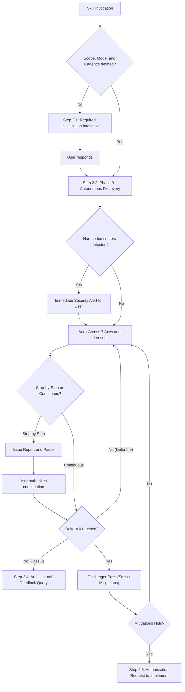
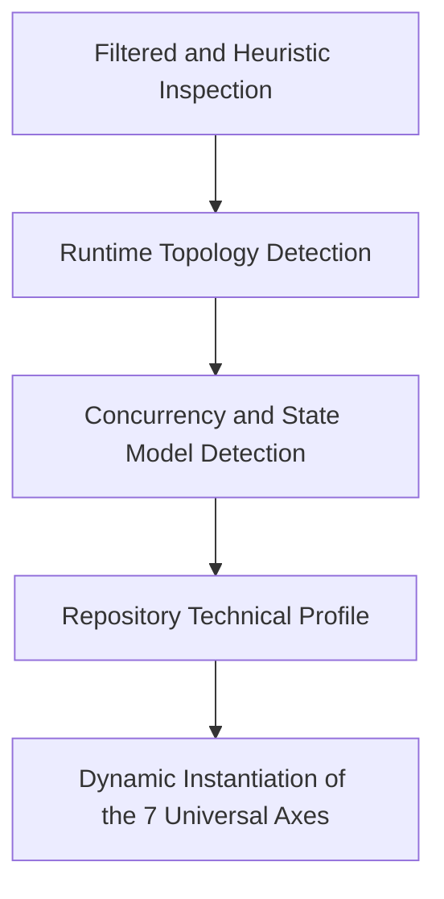
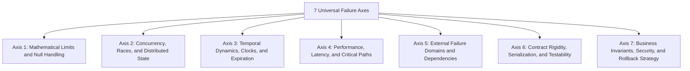
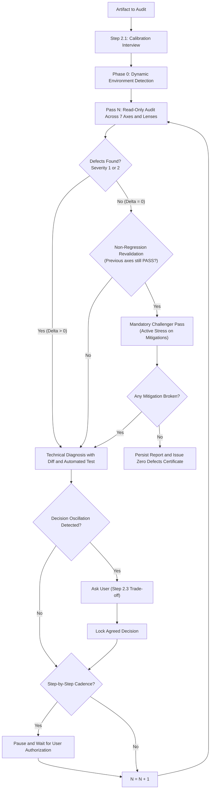

# Skill: Universal Adversarial Review and Recursive Flaw Detection

This skill defines a universal, self-adapting adversarial audit protocol. It detects architectural flaws, race conditions, bottlenecks, vulnerabilities, and contract breaches before code is written or deployed.

The skill does not assume any specific technology stack. It includes an autonomous inspection mechanism (Phase 0) that analyzes the repository structure, dependencies, variables, and configuration.

---

## 1. Iron Laws of the Adversarial Audit

### Law 1: Catastrophic Failure Assumption
```
ASSUME THE SYSTEM HAS ALREADY FAILED CATASTROPHICALLY IN PRODUCTION.
DEMONSTRATE HOW AND WHY IT FAILED UNDER ADVERSE CONDITIONS OF CONCURRENCY AND RUNTIME.
```
An adversarial auditor does not look for reasons to approve a proposal. The auditor actively seeks ways to break it through network failures, mathematical limits, concurrent events, and degraded states.

### Law 2: Read-Only and Non-Destructive Analysis
```
THE AUDIT IS STRICTLY READ-ONLY AND ANALYTICAL.
MODIFYING SOURCE CODE OR APPLYING PATCHES DURING THE AUDIT IS PROHIBITED.
```
* **Prohibited actions:** Editing source code files, applying commits, or altering production data.
* **Permitted actions:** Running read-only diagnostic tools (linters, type checking with `mypy`/`tsc --noEmit`, existing unit tests, and in-memory test scripts) without modifying the repository.

---

## 2. Calibration and Active User Interaction Protocol

When this skill is invoked, the agent must interact with the user through structured questions. This calibrates the analysis and prevents wrong assumptions.



### 2.1 Required Initialization Interview (At Skill Start)
Unless the user has defined these parameters with absolute clarity, the auditor must pause and present these calibration questions:

1. **Scope Definition:**
   * *"Which specific artifact do you want me to audit?"*
     * `(Recommended)` A technical plan or proposal (`.md`).
     * The set of recent changes (Git `diff` or modified files).
     * An isolated module or code component.
     * The full repository architecture.
2. **Rigor Mode:**
   * *"Which audit mode should we apply?"*
     * `(Recommended)` Recursive Convergence Loop ($\Delta = 0$ until zero defects are certified).
     * Quick Sweep (a single thorough pass across all 7 axes).
3. **Execution Cadence:**
   * *"How do you prefer the analysis to advance between phases and passes?"*
     * `(Recommended)` Step by step with confirmation: the auditor issues the report for each pass, pauses execution, and waits for your explicit authorization before continuing.
     * Continuous autonomous: the auditor iterates continuously until $\Delta = 0$, pausing only for business dilemmas or hard stops.
4. **Operational Constraints (if not declared in the repository):**
   * *"Is there a specific load volume, latency SLA, or production environment I should consider?"*

### 2.2 Queries and Alerts During Phase 0 (Environment Detection)
* **Immediate Alert for Hardcoded Secrets:** If the inspection detects tokens, passwords, or private keys in plain text:
  * Obfuscate the secret immediately (`***REDACTED***`).
  * Notify the user with maximum priority: *"SECURITY ALERT: Exposed secrets or credentials detected in [file:line]. They have been obfuscated in the report to protect confidentiality."*
* **Undeclared Infrastructure:** If the repository lacks a `Dockerfile`, `Procfile`, or `.env.example`, ask:
  * *"Does this service run as a single local process, a multi-worker container, or an ephemeral serverless function?"*

### 2.3 Queries During Axis Evaluation (Axes 6 and 7)
* **Contract or Public API Breakage:** If a change breaks compatibility with existing clients:
  * *"The change alters the response or signature of X. Is this modification an explicit requirement, or should backward compatibility be maintained?"*
* **Business Dilemmas and Opposing Trade-offs:** If mitigating a latency issue degrades consistency:
  * Present technical options: *"Option A prioritizes strict consistency (+40 ms). Option B prioritizes speed (<1 ms, eventual consistency). Which is the business priority?"*

### 2.4 Query at Hard Stop (Pass 5 Limit)
* If after 5 iterations $\Delta > 0$ persists, stop the loop, expose the underlying conflict, and ask:
  * *"An unresolvable architectural conflict persists between requirements A and B. Do you want to authorize a structural redesign, or accept the documented risk?"*

### 2.5 Transition Query (Closing with $\Delta = 0$)
* When issuing the Zero Defects Certificate, in compliance with the **Read-Only Law**, ask:
  * *"The technical plan has been certified with $\Delta = 0$ (zero defects). Do you authorize proceeding with the code implementation phase?"*

---

## 3. Phase 0: Autonomous Repository Discovery (Dynamic Adaptation)

Before auditing code or plans, the auditor inspects the environment to extract its real technical profile.



### Step 3.1: Filtered Inspection, Scope Partitioning, and Secrets Guard
The auditor scans the root and subdirectories up to depth level 2. It applies strict rules:

1. **Scope Partitioning Rule (Anti-Dilution):**
   If the requested audit scope contains more than two modules or three files, the auditor must not execute a single diluted pass. The auditor must decompose the scope into sequential module sub-audits. The auditor executes full convergence on each sub-scope before moving to the next.

2. **Required Exclusion List (Context Savings and Noise Prevention):**
   Scanning or reading files inside these directories is prohibited: `.git/`, `node_modules/`, `venv/`, `.venv/`, `vendor/`, `target/`, `build/`, `dist/`, `.cache/`, `__pycache__/`, and cache directories.

3. **Defensive Secrets Guard and Notification:**
   - Printing passwords, private keys, or tokens in logs or reports is prohibited.
   - If a hardcoded secret is detected in audited files, classify it as a **Severity 1** defect. Obfuscate it (`***REDACTED***`) and alert the user immediately.

4. **Dependency Manifest Detection:**
   - Detect standard files: `package.json`, `requirements.txt`, `pyproject.toml`, `Cargo.toml`, `go.mod`, `pom.xml`, `build.gradle`, `Gemfile`, `CMakeLists.txt`, `composer.json`.
   - In monorepos, generate a sub-profile for each identified module.

5. **Fallback Heuristic (Repositories Without Manifests):**
   - If no formal manifests exist (e.g., loose scripts, pure infrastructure, prompts), sample file extensions (`.tf`, `.sh`, `.ps1`, `.sql`, `.yaml`, `.py`, `.c`) and read bootstrap files (`Dockerfile`, `Makefile`) to infer the runtime.

6. **Entry Surface and Protocols:**
   - Identify how control flow enters the system: HTTP/REST, GraphQL, gRPC, WebSocket, Webhooks, Queues (AMQP/Kafka), CLI, or direct-linking libraries.

7. **Concurrency and Memory Model:**
   - Detect if the system operates with an async event loop, multi-threaded shared memory, multi-process isolated memory, or ephemeral serverless compute.

8. **Persistence and State:**
   - Identify storage: relational databases (SQL), NoSQL, distributed key-value stores, file systems, or volatile memory.

9. **Infrastructure and Configuration:**
   - Inspect `Dockerfile`, `docker-compose.yml`, Kubernetes manifests, `Procfile`, Terraform templates, and configuration schemas (`.env.example`).

### Step 3.2: Repository Profile Synthesis
The auditor generates the structured technical profile:
```text
ANALYZED SYSTEM PROFILE:
- Audited Scope: [Plan / Incremental Diff / Module / Global]
- Component(s): [Root / Specific modules in monorepo]
- Ecosystem / Language: [Detected language and runtime]
- Entry Surface: [Protocols and entry points]
- Concurrency Model: [Threads / Processes / Async / Distributed]
- State Layer: [SQL / NoSQL / Key-Value / Local Memory]
- Infrastructure: [Containers / Bare-Metal / Cloud / CLI]
```

---

## 4. The 7 Universal Failure Axes (Adaptive Instantiation)

The auditor projects the 7 universal axes onto the profile detected in Phase 0. All axes operate under a **Plausibility and Operational Realism Filter**: every Severity 1 or 2 defect must manifest plausibly under the discovered architecture, concurrency model, and SLA. The auditor discards purely hypothetical anomalies outside the domain.



### Axis 1: Mathematical Limits and Null Handling (Null / Nil Safety)
- **Boundary values:** Zero, negatives, empty collections, empty strings, single-element collections.
- **Arithmetic risks:** Division by zero, integer overflow, floating-point precision loss.
- **Null propagation:** Property access on null or undefined references (`None`, `null`, `nil`, `undefined`, unsafe unwrapping of `Option`/`Result`).

### Axis 2: Concurrency, Races, and Distributed State
- **Memory isolation:** False assumptions of shared memory between independent processes or replicas.
- **Atomic mutations:** Non-atomic read-modify-write operations in databases or caches.
- **Locks and contention:** Deadlocks, thread starvation, and high-frequency lock contention.
- **Cache coherence:** Stale data read by parallel workers after partial updates.

### Axis 3: Temporal Dynamics, Clocks, and Expiration
- **Time sources:** Use of wall-clock time instead of monotonic clocks to measure durations.
- **Time zones:** Wrong assumptions of local time vs UTC, seasonal offsets, and midnight boundary jumps.
- **Expiration semantics:** Races against key expirations (fixed vs sliding TTL), orphaned keys, and zombie states.

### Axis 4: Performance, Latency, and Critical Paths (Hot-Paths)
- **Synchronous blocking:** Remote network calls or slow disk reads inserted in critical paths that require immediate response.
- **Algorithmic complexity:** Hidden $O(N^2)$ loops, database queries inside iterations (N+1 problem).
- **Resource exhaustion:** Socket leaks, connection pool exhaustion, unbounded buffer growth without backpressure.

### Axis 5: External Failure Domains and Dependencies
- **Remote service failures:** Handling of outages, 5xx errors, rate limits, and unexpected latency changes.
- **Graceful degradation:** System behavior when non-critical auxiliary dependencies fail or become unavailable.
- **Silent masking:** Generic catch blocks that swallow exceptions without audit logging or alerts.
- **Supply chain risks:** Technical justification of new dependencies vs standard libraries, licenses, and bundle weight.

### Axis 6: Contract Rigidity, Serialization, and Required Testability
- **Type boundaries:** Implicit type coercion during serialization/deserialization (e.g., strings converted to numbers, flexible booleans).
- **Schema evolution:** Responses with missing fields, unexpected new fields, or format changes in external APIs.
- **Error containment:** Secondary services (metrics, telemetry, logs) must never raise uncaught exceptions in the main flow.
- **Required testability:** Every proposal or mitigation must include the specification of an automated test case (unit or integration) that validates the solution and prevents future regressions.

### Axis 7: Business Invariants, Security, and Rollback Strategy
- **Invariant violations:** Illegal transitions in state machines or user flows.
- **Core business transaction trace:** The auditor must trace at least one complete end-to-end business transaction. The auditor verifies domain state transitions, data transformations, input validations, and response formats against domain rules.
- **Input vulnerabilities:** Command injection, privilege confusion, access control bypasses, and plaintext credentials.
- **Interaction traps:** Flows with no cancel exit, ambiguous command names, or confusing error messages for the operator/user.
- **Reversibility and rollback strategy:** Every design must include a production rollback strategy (feature flags, bidirectional database migrations, or zero-downtime contingency procedures).

---

## 5. Algorithmic Dynamic Lens Generator

Instead of defining fixed technologies, the auditor activates lenses contextually based on the detected profile:

| If the profile detects... | The lens dynamically audits: |
| :--- | :--- |
| **External network protocols / Webhooks** | Idempotency, event deduplication, network retries, cryptographic signature validation, payload size limits. |
| **Distributed architectures / Multi-Worker** | Distributed locking, inter-node synchronization, local filesystem independence, cross-replica idempotency. |
| **Relational databases (SQL) / ACID Transactions** | Transaction isolation levels, lock acquisition order (deadlock prevention), non-blocking migrations (`ALTER TABLE`), connection pool exhaustion. |
| **Key-value stores / In-memory caches** | Eviction policies, required time-to-live (TTL), cache stampede risk, strict memory limits. |
| **Ephemeral runtimes / Serverless** | Cold start times, persistent connection leaks, improper writes to temporary disk, compute time limits. |
| **Public libraries / SDKs** | Backward compatibility, public signature stability, internal type leak prevention, strict transitive dependency control. |
| **Command-line interfaces (CLI)** | OS exit codes (0 vs !=0), signal handling (`SIGINT`, `SIGTERM`), pipe support (`stdout` vs `stderr`), undeclared environment variables. |
| **Public endpoints / Exposed APIs / Open forms** | Legitimate feature abuse vectors: mass data exfiltration, retry amplification, disproportionate per-user resource consumption, spam through transactional channels. |
| **Production deployment files (`Dockerfile`, `Procfile`, CI/CD pipelines)** | Development remnants in production code: references to `localhost`/`127.0.0.1`, hardcoded mock data, staging URLs, test credentials, active debug flags. |

---

## 6. Execution Modes and Cadence Control

1. **Quick Sweep Mode:**
   Applies a single thorough pass across all 7 axes and dynamic lenses. Recommended for small scripts, isolated functions, or scoped changes.
2. **Recursive Convergence Mode (Full Convergence Loop):**
   Executes iterative cycles of detection, mitigation formulation, and re-verification until reaching the mathematical condition $\Delta = 0$. Required for technical plans, structural changes, concurrency modules, and security components.

### Cadence Options:
* **Cadence A: Step by Step with Confirmation (Default):**
  The auditor completes each phase or iterative pass. It issues the detailed report. It **stops execution** and waits for the user to respond with authorization to continue (e.g., "continue", "proceed").
* **Cadence B: Continuous Autonomous:**
  The auditor executes Phase 0 and all iterative loop passes consecutively without interruption until $\Delta = 0$. It stops early only if an unresolved trade-off dilemma arises or the Pass 5 limit is reached.

---

## 7. Recursive Convergence Protocol ($\Delta = 0$)



### Loop Rules and Severity Metric
1. **Severity Classification:**
   - **Severity 1 (Critical):** System crashes, data corruption, exposed credentials or secrets, security failures, infinite locks, state loss, changes with no viable rollback.
   - **Severity 2 (Operational):** Race conditions, unacceptable latencies on critical paths, division by zero, incorrect time/timezone handling, resource leaks, missing automated tests.
   - **Severity 3 (Minor / Suggestion):** Style improvements, secondary optimizations, supplementary documentation.
   - **UNVERIFIED (Suspected, Not Reproducible):** Defects the auditor suspects based on code patterns or structural analysis, but cannot verify deterministically within the audit scope. Examples: timing bugs that require real load testing, race conditions dependent on production network latency. These items do not block convergence. The auditor must report them in a dedicated section with the specific reason verification was not possible.
2. **Formal Convergence Metric ($\Delta$):**
   $$\Delta = \text{Count}(\text{Severity 1}) + \text{Count}(\text{Severity 2})$$
   - Convergence is reached only when $\mathbf{\Delta = 0}$ and the non-regression verification passes.
   - Severity 3 items are reported as optional notes. They do not block convergence.
   - UNVERIFIED items are reported in a dedicated section. They do not block convergence but must be visible in the final certificate.
3. **Required Mitigation and Trace Format (Concrete Block with Diff, Test, and Call-Trace):**
   - Every recommended mitigation must provide:
     1. The exact code block or `diff` format (`--- a/file` `+++ b/file`) ready to apply.
     2. The corresponding automated test case to verify the patch.
     3. **Mandatory Call-Trace Proof:** Every Severity 1 or 2 defect must document the complete execution call trace from the external entry point to the vulnerable line. Generic pattern matches without a reachable execution path are prohibited.
4. **Anti-Oscillation Guard:**
   - If a correction in Pass $N$ reverses a decision from Pass $N-1$ due to an opposing architectural trade-off (e.g., memory vs latency):
     1. Stop the alternation immediately.
     2. Ask the user to define the business priority (Step 2.3).
     3. Formally lock the decision in the analyzed document.
     4. Block the trade-off as resolved for subsequent passes.
5. **Hard Termination Guard:**
   - If after **Pass 5** the condition $\Delta > 0$ persists, the loop must stop. The auditor must formulate the necessary questions and request a human decision (Step 2.4).
6. **Required Non-Regression Revalidation:**
   - When applying any documentary correction in Pass $N$, the auditor must re-evaluate all axes that achieved `[PASS]` in Pass $N-1$. This certifies that the mitigation did not create side effects.
7. **Mandatory Challenger Pass (Anti-Premature Closure):**
   - The auditor cannot certify $\Delta = 0$ immediately after proposing mitigations. Before issuing the Zero Defects Certificate, the auditor must execute a dedicated Challenger Pass. In this pass, the auditor actively attacks the proposed mitigations using boundary values, concurrency races, and resource exhaustion. If a mitigation fails the challenge, $\Delta$ remains greater than zero.
8. **Mitigation Traceability:**
   - Every solution proposed or adjusted in the audited document must reference the identifier of the mitigated flaw (e.g., `[Mitigation Pass 1 - Axis 1: Null Safety Guard]`).
9. **Formal Audit History Persistence:**
   - The auditor must persist the consolidated audit result in the session artifact directory or as a markdown document (`docs/audits/` or attached to the analyzed plan). This guarantees permanent historical traceability.

---

## 8. Self-Audit Capability (Meta-Recursion)

This skill can audit itself:
```
WHEN AUDITING THIS SKILL:
1. Apply Phase 0 and the 7 axes against the instructions in this document.
2. Verify that no hardcoded technology-specific dependencies or mentions exist.
3. Verify that the strict read-only and no-source-code-modification rule is current.
4. Verify the presence of the obfuscation and hardcoded secrets notification guard.
5. Verify that user interaction points and cadence options are clearly delimited.
6. Verify that the loop stopping conditions are mathematically finite and deterministic.
7. Verify sober writing style without artificial intelligence cliches.
```

---

## 9. Standard Output Templates

### Intermediate Pass Output (When $\Delta > 0$):
```markdown
### Adversarial Audit Report - Pass [N] (Mode: [Quick Sweep / Recursive Convergence] | Cadence: [Step by Step / Continuous])

**Scope and Environment Profile:**
- Scope: [Plan / Incremental Diff / Module / Global]
- Ecosystem: [Detected ecosystem] | Entry: [Surface] | Concurrency: [Model] | State: [Layer]

**Security Alerts:** [ALERT: Hardcoded secrets detected in X:Y (Obfuscated) / None]

**Defect Metric:** $\Delta = X$ (Sev 1: A, Sev 2: B)

1. [Axis / Lens] Concise Defect Name (Severity: 1/2/3)
   * **Call-Trace Proof:** [External Entry Point] -> [Module.function] -> [Vulnerable line]
   * **Failure Scenario:** Exact conditions under which the plausible failure occurs.
   * **Technical Root Cause:** Why it happens at a low level in this environment.
   * **Concrete Mitigation Proposal (Diff / Code):**
     ```diff
     --- a/file
     +++ b/file
     @@ ... @@
     + // Exact mitigation block
     ```
   * **Automated Test Case for Verification:**
     ```python
     def test_mitigation_verification():
         # Assertion that proves the flaw is resolved
         pass
     ```

**Unverified Findings (Suspected, Not Reproducible):**
- [Axis / Lens] Finding description. Reason verification was not possible: [specific reason].

---
**Questions for User (if applicable):** [Trade-off dilemmas or identified ambiguities]
**Loop Status:** [Paused, waiting for authorization for Pass N+1 / Continuing automatically]
```

### Final Closing Output (When $\Delta = 0$):
```markdown
### Zero Defects Certificate (Convergence Certified)

* **Audited Scope:** [Plan / Incremental Diff / Module / Global]
* **Mode:** Read-Only and Non-Destructive Analysis (Source code not modified)
* **Passes Executed:** N
* **Validated Profile:** [Ecosystem] | [Concurrency] | [Persistence] | [Infrastructure]
* **Final Metric:** $\Delta = 0$ (Zero Severity 1 and 2 defects)
* **Non-Regression Revalidation:** [CERTIFIED: PASS]
* **Mandatory Challenger Pass:** [CERTIFIED: PASS]
* **Rollback Strategy and Testability:** [VERIFIED: PASS]
* **Report Persisted At:** [File path or saved markdown artifact]

#### 7 Universal Axes Validation:
* [x] Axis 1 (Mathematical Limits and Null Handling): [VERIFIED: PASS]
* [x] Axis 2 (Concurrency, Races, and State): [VERIFIED: PASS]
* [x] Axis 3 (Temporal Dynamics, Clocks, and Expiration): [VERIFIED: PASS]
* [x] Axis 4 (Performance, Latency, and Critical Paths): [VERIFIED: PASS]
* [x] Axis 5 (External Failure Domains and Dependencies): [VERIFIED: PASS]
* [x] Axis 6 (Contract Rigidity, Serialization, and Testability): [VERIFIED: PASS]
* [x] Axis 7 (Business Invariants, Security, and Rollback Strategy): [VERIFIED: PASS]

#### Dynamic Lenses Activated for this Environment:
* [x] Contextual Lens [Dynamically derived lens name]: [VERIFIED: PASS]

#### Unverified Findings (Suspected, Not Reproducible):
* [Axis / Lens] Finding description. Reason: [specific reason]. Recommended follow-up: [suggested action].

**Locked Trade-offs (Agreed Technical Compromises):** [Decisions agreed with user, if applicable]
**Verdict:** Approved for implementation with zero known defects.
```
